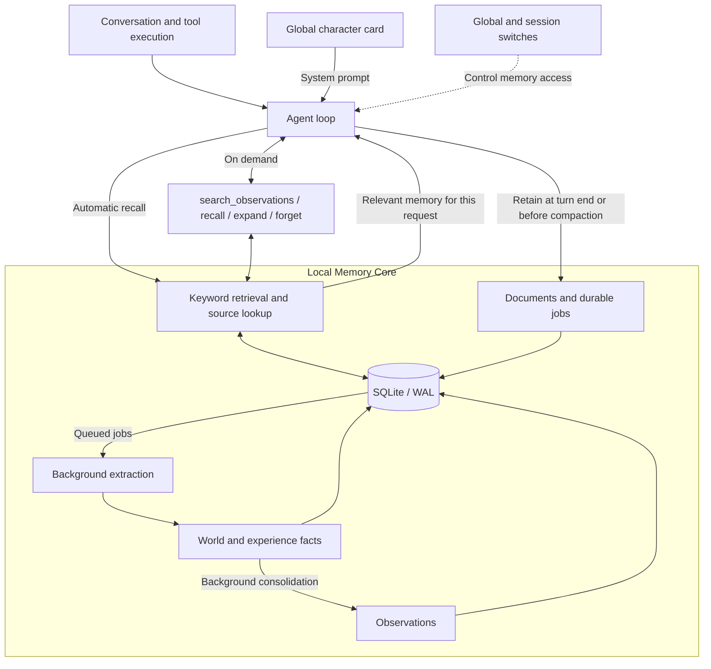

<p align="center">
  
</p>

<h1 align="center">Hikari</h1>

<p align="center">
  <strong>Some conversations don't have to start over.</strong>
</p>

<p align="center">
  A desktop AI companion with character, memory, and tools.
</p>

---

**Give her a character.** Shape her personality, background, and voice in a character card.

**Leave a trace.** Preferences, plans, and past work carry into the next conversation. Turn memory off, or ask her to forget.

**Talk. Then make things happen.** Read and write files, run commands, and connect more tools through MCP and Skills.


### Turn on the light

From the project root:

```powershell
cargo run
```

Connect your model provider in Settings. Supports OpenAI Chat Completions, Responses, and Anthropic Messages.

MCP tools are discovered on demand with `tool_search`. Web fetching and paged conversation lookup are built in; enable Tavily, Exa, or Serper search in Settings → 其它提供商. Long tool output can be read further with `artifact_read`.

Memory stays in a local database. Extraction and consolidation use your configured model. No embedding model or extra service required.

<details>
<summary>Behind the memory</summary>



Memory is shared across sessions and enabled by default in new chats. Each session can opt out.

Automatic recall returns up to 5 items within a 1000-token budget. Observation search, fact recall, and source expansion are capped at 2000, 3000, and 5000 tokens, using conservative estimates and truncation.

Documents persist before background processing. Jobs survive restarts and support retries. Turning Memory Core off stops new recall, memory tools, and document submissions; running jobs finish. Character cards, recalled material, and context summaries do not become new memory evidence.

See the [memory design](docs/pi-memory-plan.md) for details.

</details>

<details>
<summary>Under the hood</summary>

Rust · [GPUI Kit](https://gpui-kit.com/) · Pi agent loop · Hindsight-inspired memory.

| Module | Role |
| --- | --- |
| `hikari` | Desktop interface |
| `hikari-agent` | Agent loop, model protocols, and tools |
| `hikari-runtime` | Configuration, sessions, character cards, MCP, and Skills |
| `hikari-memory` | Storage, retrieval, extraction, and consolidation |

Local data lives in `.hikari/`. The global character card is `AGENTS.md`; memory is stored in `memory.db`. Edit the card in Settings or any text editor. Saved changes apply on the next turn.

API keys are saved in plaintext in the local configuration, or read from environment variables when left blank. Build with `cargo build --release`; the Windows executable is `target/release/hikari.exe`.

[Integration guide](docs/pi-port.md) · [Developer handoff](docs/handoff.md)

</details>

### Built on

Memory design inspired by [Hindsight](https://github.com/vectorize-io/hindsight). Agent core adapted from [Pi](https://github.com/Dicklesworthstone/pi_agent_rust).

MIT. Adapted Pi code retains its [upstream license](licenses/pi_agent_rust.LICENSE), including the original rider terms.
