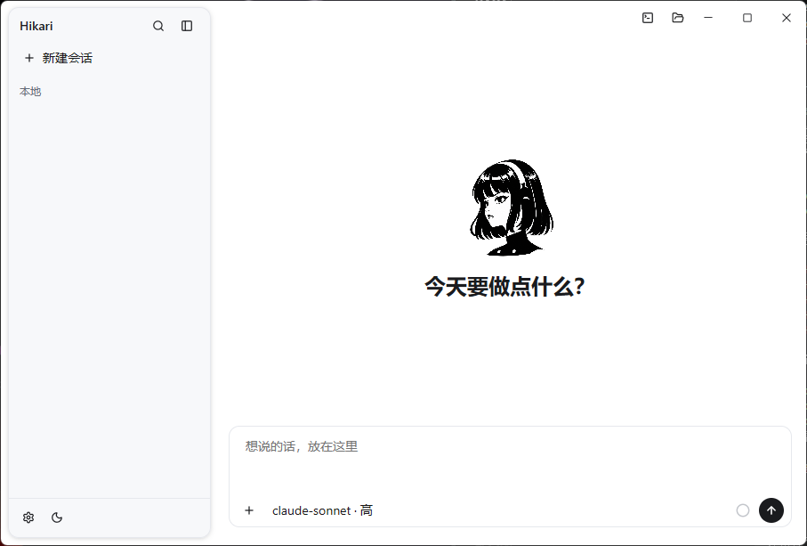

# Hikari

基于 Rust、[Gpui_kit](https://gpui-kit.com/) 实现的伴侣型个人助手，定义它的性格，在所有对话中养成你们的关系吧。

当前第一阶段是 Pi agent 与 GPUI 接入：工具 loop、Chat Completions / Responses / Anthropic 协议、stdio / Streamable HTTP MCP、Skill 发现与按需加载、会话恢复。运行 `cargo run -p hikari`。实现范围、Pi 代码来源和配置说明见 [Pi 接入文档](docs/pi-port.md)。Hindsight Memory Core 尚待实现。

## visual

## License
MIT

移植的 Pi 代码沿用其 [上游许可证](licenses/pi_agent_rust.LICENSE)，包括原有 rider 条款。

## 致谢
- 长期记忆计划参考 [hindsight](https://github.com/vectorize-io/hindsight)，以 Rust 实现简版 memory core；
- agent core基于 [pi_agent_rust](https://github.com/Dicklesworthstone/pi_agent_rust1) 二次开发
